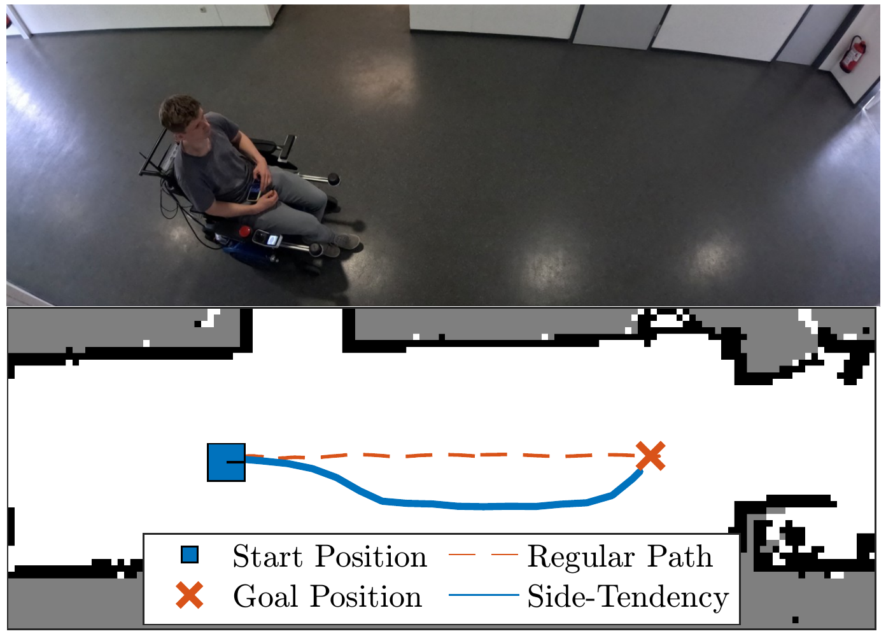
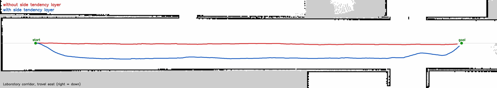

# Side Tendency Layer: Enhancing Social Robot Navigation for Passenger and Pedestrian Comfort Using Local Sensor Data

<p align="center">
  
</p>

Implementation of our paper **"Side Tendency Layer: Enhancing Social Robot Navigation for
Passenger and Pedestrian Comfort Using Local Sensor Data"**, ECMR 2025,
doi: [10.1109/ECMR65884.2025.11163026](https://doi.org/10.1109/ECMR65884.2025.11163026).

The side tendency layer is a [Nav2](https://nav2.org) costmap layer that makes a robot keep to one
side of a corridor, like pedestrians do. It detects the walls left and right of the robot in the
laser scan and lays a comfort function across the corridor as costs. Wherever no valid corridor is
detected, the layer adds nothing and the rest of the costmap works as usual. The repository also
contains the simulation scenarios of the paper, so the results can be reproduced with the Nav2
tutorial TurtleBot3.

## Installation

Tested with ROS 2 Humble on Ubuntu 22.04.

```bash
mkdir -p ~/side_tendency_ws/src && cd ~/side_tendency_ws/src
git clone https://github.com/FAU-FAPS/side_tendency_layer.git
cd ~/side_tendency_ws
rosdep install --from-paths src --ignore-src -y
colcon build
source install/setup.bash
```

## Usage

Add the layer to the plugins of the global costmap, after the inflation layer:

```yaml
global_costmap:
  global_costmap:
    ros__parameters:
      plugins: ["static_layer", "obstacle_layer", "inflation_layer", "side_tendency_layer"]
      side_tendency_layer:
        plugin: "side_tendency_layer/SideTendencyLayer"
        enabled: True
        scan_topic: /scan
        # Corridor detection
        perception_range: 1.5      # [m] scan points and costs this far ahead
        corridor_min_width: 1.5    # [m] narrower corridors get no side tendency
        corridor_max_width: 5.0    # [m] wider areas are not treated as corridor
        min_wall_points: 5         # scan points needed on each side
        min_wall_length: 0.2       # [m] shortest wall that counts
        max_wall_mae: 2.5          # [m] no corridor if the MAE of both walls is larger
        min_slope_product: -0.3    # walls are not parallel if the product of their slopes is lower
        score_alpha: 0.5           # alpha in Eq. 7, weight of R^2 against the MAE term
        score_lambda: 10.0         # lambda in Eq. 7, sensitivity to the MAE
        # Comfort function (Eq. 1 and 2)
        comfort_a: 0.1             # discomfort close to the walls
        comfort_b: 0.4             # sensitivity to leaving the preferred position
        comfort_c: 0.99            # preferred position, 0 = left wall, 1 = right wall
        comfort_eta: 0.604         # normalises the maximal comfort to 1
        # Cost representation
        max_cost: 127              # cost of the least comfortable position
        sample_step: 0.03          # [m] spacing of the sampled cost points
```

These are the values of the simulation config `config/nav2_tb3_side_tendency.yaml`, tuned for the
TurtleBot3. `perception_range`, `corridor_min_width`, `corridor_max_width` and `comfort_b` differ
from the defaults in the table below. The scanner may use any angle convention, from 0 to 2π or
from −π to π. The scan frame must be connected to the costmap's global frame by TF.

### Parameters

All parameters are read from the layer's namespace and can be changed at runtime with
`ros2 param set`, except `scan_topic`. Defaults are the values of the paper's experiments.

| Parameter | Paper | Default | Description |
|---|---|---|---|
| `enabled` | | `true` | Whether the layer adds costs |
| `scan_topic` | | `/scan` | `sensor_msgs/LaserScan` topic |
| `perception_range` | r | `1.0` | Scan points this far ahead [m] are used, and costs are drawn this far ahead. A short range delays the side shift. |
| `corridor_min_width` | | `2.0` | Narrower corridors [m] get no side tendency |
| `corridor_max_width` | | `6.0` | Wider areas [m] are not treated as corridor |
| `min_wall_points` | | `5` | Scan points needed on each side |
| `min_wall_length` | | `0.2` | Shortest wall [m] that counts |
| `max_wall_mae` | MAE limit | `2.5` | No corridor if the mean absolute error of both walls is larger [m] |
| `min_slope_product` | parallel check | `-0.3` | Walls count as not parallel if the product of their slopes is lower |
| `score_alpha` | α | `0.5` | Weight of R² against the MAE term in the wall confidence score |
| `score_lambda` | λ | `10.0` | Sensitivity of the confidence score to the MAE |
| `comfort_a` | a | `0.1` | Discomfort close to the walls |
| `comfort_b` | b | `0.3` | Sensitivity to leaving the preferred position |
| `comfort_c` | c | `0.99` | Preferred position across the corridor, 0 = left wall, 1 = right wall |
| `comfort_eta` | η | `0.604` | Normalises the maximal comfort to 1 |
| `max_cost` | | `127` | Cost of the least comfortable position, at most 252 |
| `sample_step` | | `0.03` | Spacing of the sampled cost points [m] |

## Simulation

Each scenario has its own launch file. It starts the Nav2 tutorial simulation
(`nav2_bringup/tb3_simulation_launch.py`: Gazebo, TurtleBot3 waffle, AMCL, Nav2 with DWB, RViz)
with `config/nav2_tb3_side_tendency.yaml` and the scenario's world, map and poses. Worlds, maps
and models all come with this package. As in the paper's simulation, the layer runs in the global
costmap only. DWB and the layer use the tuning of the paper's simulation config, and the
inflation layer keeps the Nav2 default.

<p align="center">
  
</p>

*TurtleBot3 in the laboratory scenario, driving east. Red: plain Nav2. Blue: with the side
tendency layer, the robot keeps to the right.*

| Launch file | Scenario | Demo route in the map frame |
|---|---|---|
| `sim_office.launch.py` | Simulation of Figure 6a in the paper: a loop around an inner block with corridors of different widths, doors, a crossing, pedestrians and cluttered areas | Through the four corners of the loop, taken from the global plan of the paper's run |
| `sim_laboratory.launch.py` | Long corridor of a laboratory, 2.9 m wide | `7 -3.45 0`, east end of the corridor |
| `sim_straight_corridor.launch.py` | Straight 20 m corridor, 2.85 m wide | `17 0 0`, end of the corridor |
| `sim_doorway.launch.py` | Straight corridor with a doorway | `17 0 0`, end of the corridor |
| `sim_intersection.launch.py` | Crossing of two corridors | `17 0 0`, through the crossing |
| `sim_corridor_turns.launch.py` | Corridor with two turns, about 1.7 to 1.9 m wide | `12.3 -6.1 0`, right arm of the cross-shaped room |

```bash
ros2 launch side_tendency_layer sim_office.launch.py
ros2 launch side_tendency_layer sim_office.launch.py side_tendency:=false   # baseline
```

Once Nav2 is up, `scripts/demo_goal.py` drives the demo route and logs the remaining distance.
All launch files take the same arguments, and the scenario's values can be overridden:

| Argument | Effect |
|---|---|
| `side_tendency:=false` | Baseline: the same parameters without the layer |
| `demo_goal:=false` | No demo route, e.g. for `corridor_trial.py` or goals from RViz |
| `goals:="x y yaw; x y yaw"` | Demo route in the map frame |
| `headless:=True use_rviz:=False` | No windows |
| `x_pose:=`, `y_pose:=`, `yaw:=` | Spawn pose in the Gazebo world |
| `initial_x:=`, `initial_y:=`, `initial_yaw:=` | AMCL initial pose in the map frame, by default the spawn pose |
| `params_file:=` | Other Nav2 parameters |

The maps of `straight_corridor`, `doorway`, `intersection` and `corridor_turns` were recorded with
SLAM from the spawn pose. Their map frame is therefore the spawn pose: AMCL starts at the map
origin and the robot faces along the map's x-axis. The other maps are in the world frame.

The scenario files include `simulation.launch.py`, which also runs your own world and map:

```bash
ros2 launch side_tendency_layer simulation.launch.py world:=/path/to/my.world \
  map:=/path/to/my.yaml x_pose:=1.0 y_pose:=2.0 goals:="10 2 0"
```

### Trials

`scripts/corridor_trial.py` drives from start to goal, records the path and prints the lateral
offset. Launch with `demo_goal:=false`, so that two goals do not compete. Start and goal are in
the map frame:

| Scenario | Start | Goal |
|---|---|---|
| `laboratory` | `-17 -3.45 0` | `7 -3.45 0` |
| `straight_corridor`, `doorway`, `intersection` | `0 0 0` | `17 0 0` |
| `corridor_turns` | `0 0 0` | `6.5 0 0` |

```bash
ros2 launch side_tendency_layer sim_doorway.launch.py demo_goal:=false
ros2 run side_tendency_layer corridor_trial.py --start 0 0 0 --goal 17 0 0 --out st.csv
```

Lateral offset over the middle 80 % of the way, negative = right of the travel direction:

| Scenario | Corridor width | Without layer | With layer |
|---|---|---|---|
| `laboratory` | 2.9 m | -0.05 m | -0.85 m |
| `straight_corridor` | 2.85 m | -0.10 m | -0.82 m |
| `doorway` | 2.85 m | -0.07 m | -0.68 m |
| `intersection` | 2.85 m | -0.12 m | -0.87 m |
| `corridor_turns`, first leg | 1.73 m | -0.04 m | -0.36 m |

The TurtleBot config sets `corridor_min_width` to 1.5 m, so that the layer also acts in the
narrow legs of `corridor_turns`. With `perception_range` 1.0 m and the Nav2 default DWB settings,
the robot needed about 11 m of driving to complete the side shift in the laboratory. With 1.5 m it
needs under 2 m.

### Troubleshooting

If `spawn_entity.py` fails with `No module named 'lxml'`, the `python3` first on the `PATH`, for
example one from pyenv, lacks lxml. Start with the system Python first, `PATH=/usr/bin:$PATH ros2
launch ...`, or install lxml into that Python.

## Citation

If you use this work, please cite our paper:

```bibtex
@inproceedings{kalenberg2025sidetendency,
  author    = {Kalenberg, Matthias and Li, Song and Engelhardt, Helmut and Walter, Jonas and Franke, J{\"o}rg},
  title     = {Side Tendency Layer: Enhancing Social Robot Navigation for Passenger and Pedestrian
               Comfort Using Local Sensor Data},
  booktitle = {2025 European Conference on Mobile Robots (ECMR)},
  year      = {2025},
  doi       = {10.1109/ECMR65884.2025.11163026}
}
```

## License and acknowledgement

MIT License, see [LICENSE](LICENSE). The Gazebo models in `models/` are licensed under
CC BY 3.0, see [models/README.md](models/README.md).

This work was supported by the Federal Ministry of Education and Research (BMBF) under funding
code 16SV9306.
